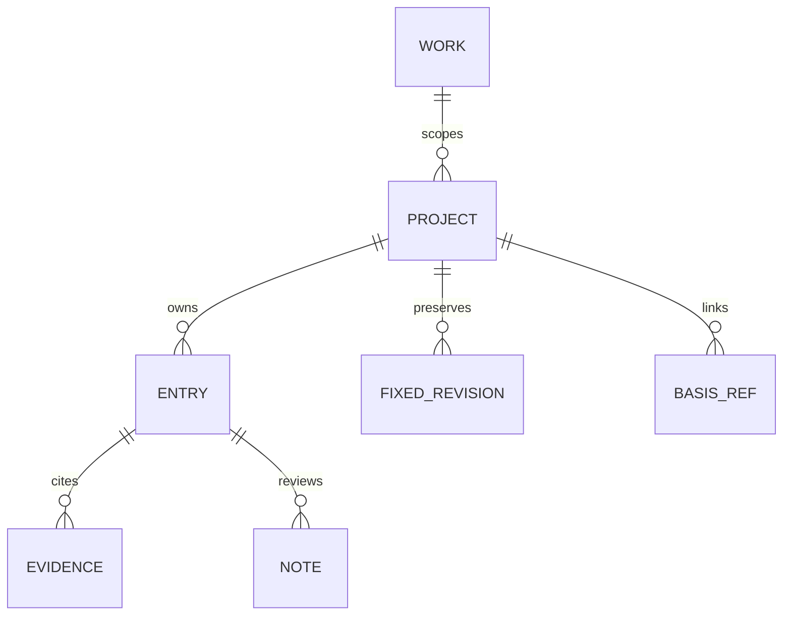

# 领域与本体设计

## 专业聚合与事实归属

Person人物身份、Evidence固定证据、Event生平事件、Identity身份辨析、Chapter传记章节、Note固定意见。一个专业工程内维护相关集合，避免为每个小对象建立数据库或独立服务。根字段为people、evidence、events、identities、chapters、notes、basis_refs。

作品、正式正文、设定、原始资料、素材和事务归宿主Core。专业对象及其固定修订属于本包；跨插件依据固定owner_plugin_id、object_id、revision和sha256。WorkRef区分小说、剧本、视频，同一名字、ID片段或目录不扩大授权。

## 不变量

日期保留原文字面。首版normalize_date仅解释公历YYYY、YYYY-MM、YYYY-MM-DD、明确范围与before/after；about/不确定、未知历法与纪年不猜换算。严格校验闰日和上下界。不同人物即使同名也保持独立ID，身份关系是有证据的声明，冲突并列显示。事件可以保留互相矛盾的说法；时间检查只在区间明确不相交时判定先后。章节固定事件组合摘要，生平信息变化后旧叙述与意见待复核，不重写旧事件证据。

所有集合ID在自身范围唯一；任何引用必须存在，顺序在各自父级内唯一。移除被引用项前先显式处理关系，整本保存也不能绕过原件和核实记录的历史保护。来源只追加，不能将已有索引改指另一份材料。

## 解释与作者决定

程序执行可重复规则，Agent解释与准备候选，作者保留取舍、采纳和定稿。专业状态只是检查依据；无法判断时保留缺口，不能用默认值掩盖。内容改变形成新专业修订，旧意见坐标和依据不静默移到新稿。
